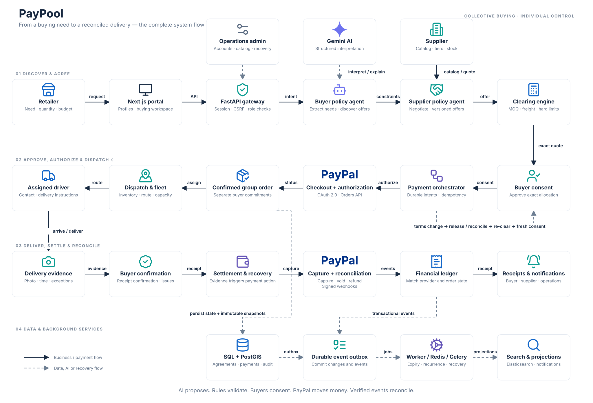
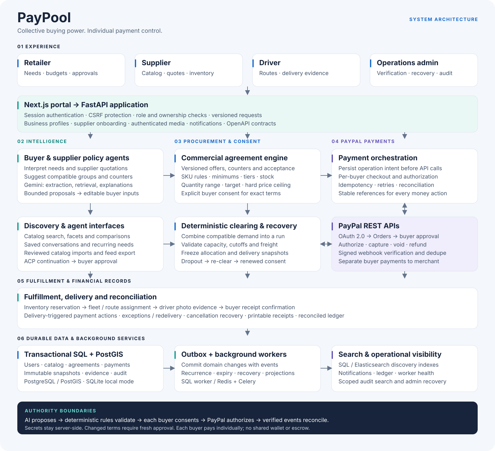

<p align="center">
  
</p>

<p align="center"><strong>Collective buying power. Individual payment control.</strong></p>

# PayPool

[Live demo](https://paypool-ai.vercel.app) · [Source repository](https://github.com/akshayks13/PayPool)

Independent shops combine wholesale demand into a viable supplier delivery run.
Each buyer keeps a hard delivered-price limit, approves an exact allocation and
authorizes their own purchase. If someone leaves, PayPool releases old commitments
and requires fresh consent for revised terms.

## System flow

[](docs/assets/paypool-system-flow.png)

Follow the arrows across the first row, back across the second, and forward
through delivery and settlement. Dashed arrows show AI, data and recovery paths.

[Full-resolution flow diagram](docs/assets/paypool-system-flow.png) ·
[Editable flow SVG](docs/assets/paypool-system-flow.svg)

## System architecture

The complete system connects retailer, supplier, driver and operations portals
to AI-assisted negotiation, deterministic group purchasing, individual PayPal
payments and delivery reconciliation. Each buyer controls their own approval;
the platform coordinates the agreement and its lifecycle.

[](docs/assets/paypool-architecture.png)

[Full-resolution diagram](docs/assets/paypool-architecture.png) ·
[Editable SVG](docs/assets/paypool-architecture.svg) ·
[Architecture details](docs/architecture.md)

## Start the app

For a public demo, see [free deployment on Vercel, Render and Neon](docs/deployment.md).

Requires **Python 3.12+ and Node.js 22+**. From this directory:

```sh
make setup   # first time: installs backend and frontend dependencies
make dev     # starts API, web app and background worker together
```

Open **http://localhost:3000**. API documentation: **http://localhost:8000/docs**.
Stop all three processes with Ctrl+C. After installation, only `make dev` is needed.

For a fresh recording/demo, stop the current run and use `make demo`. It uses a
new, separate database and preserves existing development data. The terminal
prints the retained demo database path. `make dev` uses persistent SQLite at
`backend/data/paypool.db`. Docker, Redis and PostgreSQL are not needed locally.

`make demo` also prepares the same four walkthroughs for every teammate:

| Delivery date | Prepared scene |
| --- | --- |
| Tomorrow | Three 30 kg Harvest rice requests, ready for the supplier to clear into $48 allocations |
| In two days | Three approved and authorized orders, ready for withdrawal recovery |
| In three days | Dispatched route, with Ananya's delivery evidence still to record |
| In four days | Completed deliveries with matched receipts for all three buyers |

Dates are calculated at setup in Asia/Kolkata and printed with pool identifiers.
The first run already includes Ananya's request: use AI comparison for the demo,
then clear the existing three-buyer run. Submitting again after it is locked
creates a separate run. `make dev` keeps the basic seed and existing data; it does
not inject walkthrough purchases into a working database.

Select a demo account and click Sign in. Development password: **PayPool-demo-2026!**.
These accounts are refused when demo mode is disabled.

| Account | Role |
| --- | --- |
| ananya@paypool.demo | Retailer / GreenMart |
| rahul@paypool.demo | Retailer / Corner Store |
| meera@paypool.demo | Retailer / Fresh Basket |
| seller@paypool.demo | Supplier / Sree Distributors |
| driver@paypool.demo | Driver / Kiran |
| admin@paypool.demo | Operations administrator |

Use separate browser profiles for multiple roles. Businesses, USD prices and
coordinates are fictional demo fixtures. Local walkthroughs simulate payments;
the hosted demo uses PayPal Sandbox. Neither moves real money.

On the hosted demo, judges can select these accounts or choose **Create an
account** on the sign-in page for a new retailer workspace. Supplier access
requires an application and administrator approval. Labelled judge examples
include a three-shop group ready to optimize and a two-shop cleared quote.
Fresh examples are prepared daily without fabricating payments or deliveries.
Render may take about a minute to wake after inactivity.

## Judge walkthrough and PayPal testing

Open **https://paypool-ai.vercel.app**. No installation or API keys are needed
to try the hosted app. Use the demo accounts above, or create a retailer account.

1. As a retailer, explore **Buy with PayPool**, supplier products and shared buying groups.
2. As the supplier, open **Shared orders** and optimize the labelled three-shop
   example into a final quote. Existing requests are already seeded; do not add duplicates.
3. Switch to each participating retailer to review and approve their individual quote.
4. Open **My orders**, choose **Pay with PayPal**, and sign in with a **Personal
   PayPal sandbox account**. Approve the test checkout; PayPal returns to PayPool,
   where the order should show **AUTHORIZED**.
5. Use the driver account to inspect delivery workflows and the administrator
   account to inspect worker health, audit history and payment operations.

**The PayPool demo login and PayPal sandbox login are separate accounts.**
Use the Personal sandbox buyer credentials supplied privately in the Devpost
testing instructions, or your own Personal sandbox account. Do not use a real
PayPal account or the receiving Business sandbox account to approve its own purchase.
Sandbox credentials and API secrets are not published in this repository.

Authorization reserves the approved test amount. Capture is a separate step
after the required delivery checks; an authorized order is not yet captured.
The hosted checkout, buyer approval, $49 authorization and signed webhook have
been verified. Capture after delivery remains unverified end to end.

The hosted dataset is shared, so examples may change as other testers use them.
For the four repeatable local scenarios, use `make demo`: it explicitly forces
simulated payments, even when sandbox credentials are configured locally.

To try real PayPal Sandbox checkout on localhost instead, stop the current app,
configure sandbox `PAYPAL_CLIENT_ID` and `PAYPAL_CLIENT_SECRET` in `backend/.env`,
and run **`make sandbox`**. This starts the API, frontend and worker with a separate
persistent SQLite database at `backend/data/paypal-sandbox.db` and labelled buying
examples. Approve a quote, open **My orders**, and complete checkout using a Personal
sandbox buyer. The return URL points to localhost. This does not change the hosted
webhook listener; receiving signed webhooks locally requires a separately configured
public HTTPS listener.

## What works

- Business/contact/delivery profiles, notification preferences and protected address changes.
- Supplier application, rejection/correction/resubmission, administrator approval and account disable/reactivation.
- Supplier catalog, tier prices, stock movements, reviewed CSV/XLSX imports and authenticated product-photo uploads.
- Catalog search/facets/pages, saved buying conversations, Gemini-assisted interpretation/explanations, quantity range, preferred target and hard ceiling.
- Buyer/supplier policy recommendations, versioned offers/counters/rejection, comparison and revision history.
- Editable delivery zones/schedules, fleet, capacity/freight clearing and immutable individual approvals.
- Simulated or configured sandbox checkout, durable financial recovery and renewed approval after group changes.
- Assigned driver routes, snapshotted delivery contacts, photo evidence, exceptions/redelivery and buyer confirmation.
- Reconciled printable receipts, notifications, audit search, worker health, ledger and job recovery.

## AI and PayPal integration

Server-only settings live in ignored `backend/.env`; start from `.env.example`
only for a new checkout, preserving any existing key file.

**Gemini:** set `GEMINI_API_KEY`, `PAYPOOL_LLM_PROVIDER=gemini` and optionally
`PAYPOOL_GEMINI_MODEL` (default `gemini-2.5-flash`). Without a key, the local default
is explicitly labelled offline interpretation. The team's local key is not in Git.

**PayPal:** the hosted deployment uses PayPal Sandbox; local walkthroughs use
simulation. Sandbox OAuth, real checkout creation, Personal buyer approval,
$49 authorization and a signature-verified webhook have been verified on the
hosted app. Capture after delivery has not yet been verified end to end.
To configure your own deployment, set `PAYPOOL_PAYMENT_PROVIDER=paypal_sandbox`,
`PAYPAL_CLIENT_ID`, `PAYPAL_CLIENT_SECRET`, `PAYPAL_WEBHOOK_ID` and `PAYPAL_SELLER_ID`.
Use sandbox merchant/buyer accounts and real verified webhook events. Optional
PayPal Login is configured separately through `PAYPAL_LOGIN_ENABLED` and a
registered callback. This build supports one configured merchant, not a pooled
wallet, escrow or automatic multi-merchant payout.

The integration uses PayPal OAuth 2.0 for server authentication, Orders API v2
for checkout and authorization, Payments API v2 for capture, void and refund,
and the Webhooks API for registration and signature verification before
reconciling provider state. Gemini interprets purchasing requirements and
explains recommendations; backend rules validate prices, quantities and approvals.

For a separate sandbox deployment, register its HTTPS webhook listener at
`/api/v1/webhooks/paypal` and save the resulting ID as `PAYPAL_WEBHOOK_ID`.
Set `PAYPOOL_FRONTEND_URL` to your frontend origin so checkout returns and origin
checks match. `PAYPAL_SELLER_ID` is the connected distributor's internal PayPool
ID (`seller-demo` for the seeded distributor). See [deployment instructions](docs/deployment.md).

Optional PostgreSQL/PostGIS, Redis/Celery and Elasticsearch configuration is in
`backend/.env.example` and `compose.yaml`. Their local fallback is sufficient for
the demo. Do not treat a configured adapter as a verified deployment.

## Code and checks

```text
frontend/   Next.js / React / TypeScript portal
backend/    FastAPI, SQLAlchemy, domain rules, solver, integrations and workers
contracts/  Current OpenAPI, pinned external-agent schemas and Postman collection
```

Run checks appropriate to changed code:

```sh
(cd backend && .venv/bin/python -m pytest -q tests/test_business.py)
(cd frontend && npm run typecheck)
(cd frontend && npm run test:e2e -- e2e/business.spec.ts)
```

`make test` runs all backend tests plus typechecking. `npm run build` in `frontend`
checks a production build; stop the local frontend first. `make postman-demo`
starts a disposable API and executes the 32-request simulator walkthrough without
changing your working database. It downloads the pinned Newman runner on first use.

Images are authenticated, limited to PNG/JPEG/WebP up to 2 MB and 16 megapixels,
normalized to at most 2048 px, stripped of embedded metadata and stored in SQL.
There is a 100-image limit per account. Internal images are not published in feeds.

## Project notes

- [Current scope and remaining setup](docs/STATUS.md)
- [Architecture](docs/architecture.md)
- [Demo walkthrough](docs/demo.md)
- [Submission description and video plan](docs/hackathon-submission.md)
- [External-agent interface](docs/acp.md)

Historical prompts, audits and prototype screens were removed from the current
tree; Git retains their history. Keep submissions aligned with the actual build.
