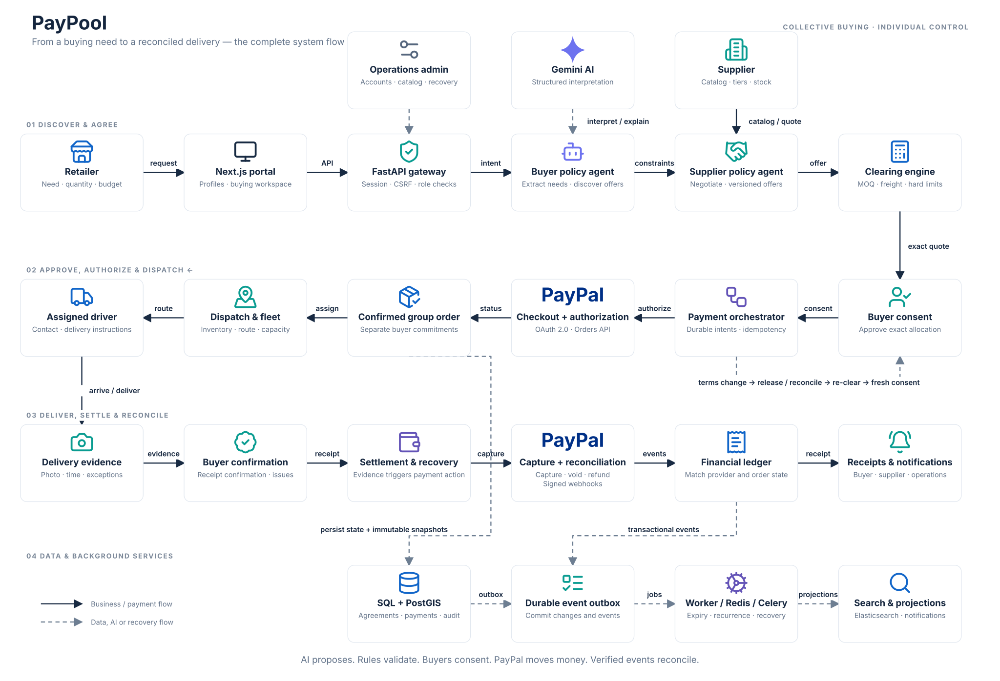
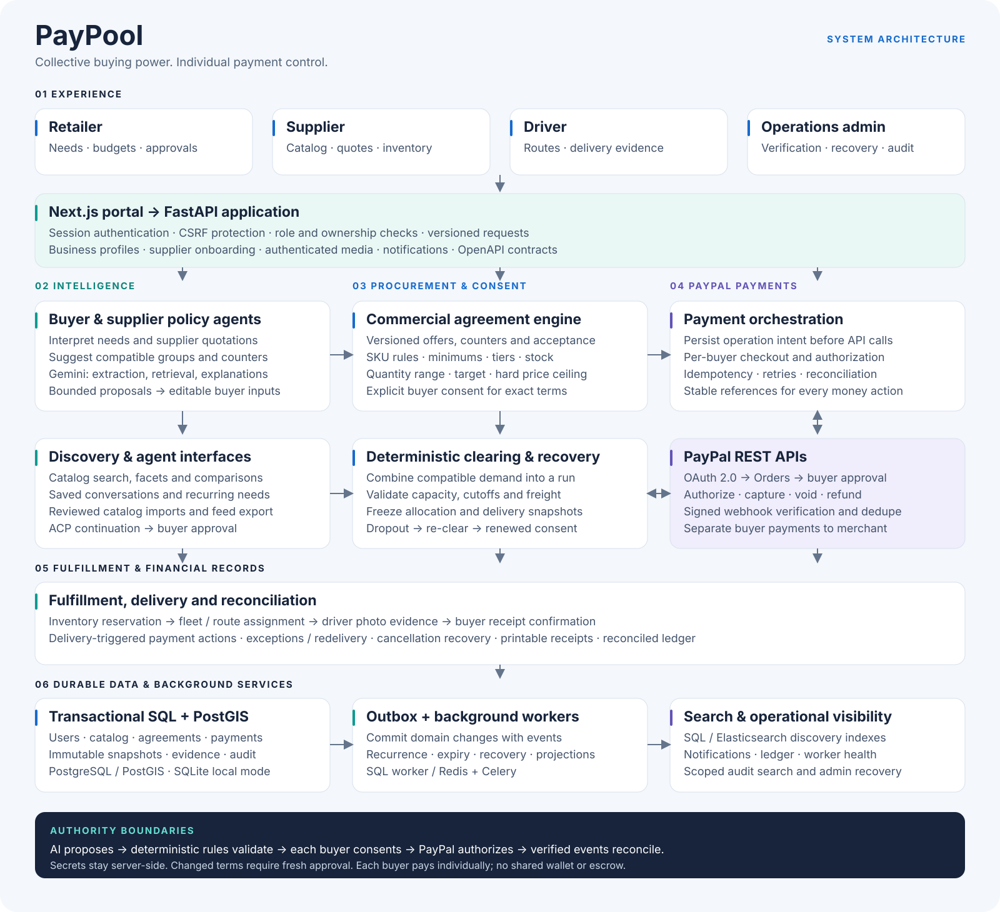
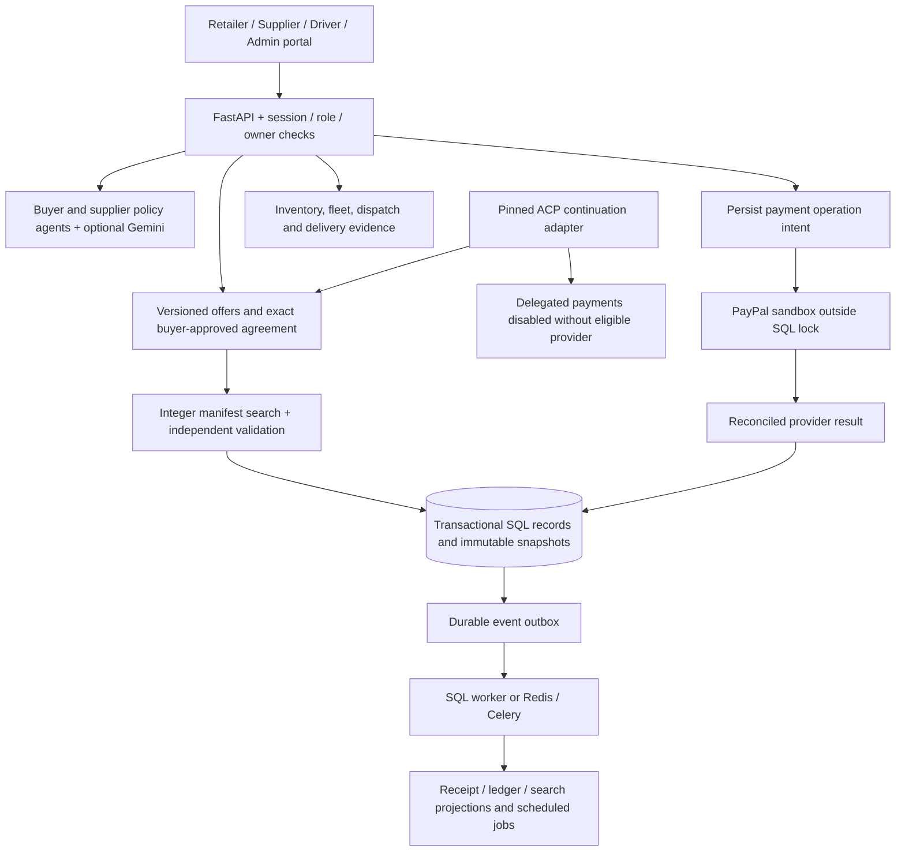

# PayPool application architecture

## End-to-end flow

[Full-resolution PNG](assets/paypool-system-flow.png) · [Editable SVG](assets/paypool-system-flow.svg)

Solid arrows trace the business and payment journey; dashed arrows connect AI,
durable data, background jobs and the renewed-consent recovery path.

## Component overview

[Full-resolution PNG](assets/paypool-architecture.png) · [Editable SVG](assets/paypool-architecture.svg)

The overview shows the complete integration design, including PayPal REST APIs,
individual buyer authorization, capture, void, refund and verified webhook events.
The flow below focuses on the application's transaction and authority boundaries.

## Boundaries

- `platform/models.py` validates requests and merchant configuration; `service.py` owns authoritative procurement and fulfillment rules.
- `commercial.py` owns two-party offers, immutable revision history and seller/buyer commercial authority.
- `conversations.py` stores the buyer's current task and bounded clarification history. Optimistic versions reject stale device/model responses; restored tasks require fresh discovery rather than reusing stored executable prices.
- `clearing.py` searches permitted whole quantities, evaluates earned SKU tiers and physical constraints, allocates every freight cent and validates the chosen manifest independently.
- `schedules.py` owns cutoff calculations; `worker.py` creates recurring requests and processes expiry, event projections and recovery.
- `payment_execution.py` persists provider operation intent, releases SQL locks, invokes PayPal and commits or reconciles the result. Conflicting operations are rejected. Delivery evidence commits before capture is attempted.
- `payments.py` is the explicit demo/PayPal sandbox adapter; a browser redirect is never payment proof.
- `store.py` serializes domain mutations across SQLite or PostgreSQL workers. Outbox events are committed in the same transaction as the originating audit/domain mutation.
- `acp.py` validates the pinned upstream protocol and buyer-approved quote. It provides a portal continuation while delegated processing is disabled.
- `feed.py` prepares reviewed factual discovery rows. `search.py` provides optional Elastic/Gemini retrieval; SQL owns current eligibility, stock, prices and consent.
- `features_router.py` exposes offers, recurrence, fleet, inventory, manifestations of delivery evidence, feed preparation and operations. `router.py` exposes the core account/procurement/payment workflow.
- Catalog facets and audit history use server pagination. Audit SQL filters authorization before search/count/pagination; users cannot enumerate another buyer's activity through totals or search.

## Authority and money

A parsed request is not an order. An accepted commercial offer is not a final freight quote. A cleared quote is not buyer approval. Buyer approval is not PayPal authorization. A driver's evidence is not independent receipt confirmation. Each transition is recorded and checked separately.

A single configured merchant receives separate buyer payments in the current sandbox integration. No pooled wallet or escrow balance exists. A changed group agreement requires release/reconciliation of old commitments and new buyer consent.

## Browser checkout and authorization

`paypal-checkout.tsx` loads PayPal's JavaScript SDK through the official
`@paypal/paypal-js` loader, with sandbox mode, the approved currency and
`intent=authorize`. SDK loading is shared per client/currency. Each order owns
its own button, callbacks and cleanup. The button is interactive only after
initialization; slow or failed loading offers a full-page fallback.

The SDK `createOrder` callback invokes the authenticated server checkout route
and returns its persisted provider order ID. `onApprove` invokes the server
another time to authorize that same purchase. Currency and total are checked
against the approved allocation; optional PayPal amount breakdown fields do not
change those checks. The browser cannot supply a price or mark an order paid.
A successful popup callback must return server state **AUTHORIZED**. Cancellation
keeps checkout retryable; failed or uncertain authorization requires reconciliation.

The public config exposes the SDK client ID only. OAuth credentials and webhook
verification stay server-side. Local SQLite and hosted Neon use the same payment
execution rules. [Payment verification notes](payments.md) distinguish proven
sandbox authorization from the unverified real-provider capture/refund lifecycle.

## Operational envelope

One request per buyer per run, six buyers, one vehicle and an explicit 30,000-manifest budget. Domain records are stored as SQL JSON documents with an Alembic baseline. The architecture is a modular monolith; a distributed microservice topology or an unbounded optimizer is not claimed. See [project scope](STATUS.md) for account/service dependencies and validation evidence.

## Business accounts and images

`business.py` owns versioned supplier applications/reviews and account controls.
`media.py` validates and normalizes product/delivery images, stores them in SQL,
and checks catalog/order authorization on every read. Profile updates preserve
login identity and roles; delivery contacts are snapshotted into agreements.
