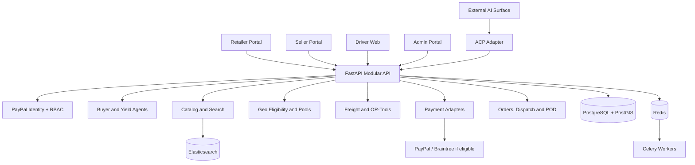

# PayPool — System Architecture
**Architecture:** modular monolith for the hackathon MVP, with background workers and isolated provider adapters.

## 1. Architecture decisions
| Layer | Choice | Purpose |
|---|---|---|
| Portal | Next.js App Router, TypeScript, Tailwind | Retailer, seller, driver and admin experiences |
| API | Python 3.12+, FastAPI, Pydantic v2 | Modular domain API |
| Persistence | PostgreSQL 16 + PostGIS, SQLAlchemy 2, Alembic | Transactions and geospatial queries |
| Search | Elasticsearch hybrid keyword/vector | Catalog and substitute retrieval |
| Optimization | Google OR-Tools CP-SAT or MIP | Deterministic allocation and constraints |
| Async | Redis + Celery | Webhooks, pool recalculation, notifications, receipts |
| AI | Provider-neutral LLM client with structured tool calls | Buyer and seller agents |
| Payments | PayPal sandbox adapter; optional domestic India adapter | Portal checkout and provider isolation |
| ACP | Separate protocol adapter; Braintree delegated-token path only if eligible | External agent commerce |
| Local infra | Docker Compose | Reproducible team development |

The original PRD lists Astropods, Channel3, Elastic, KERNEL, Render, AG Grid, Bryntum, APIMatic, Postman and Zapier. These are not all required MVP dependencies. Use functional equivalents unless the team already has access and a working integration. Implement price-ceiling rules in deterministic domain code rather than relying on a proprietary runtime.

## 2. System context


## 3. Twelve logical modules
1. Identity & RBAC — PayPal login, account linking, internal roles and permissions (Member 1).
2. Retailer Experience — dashboard, copilot, requests and approval UI (Member 1).
3. Seller & Catalog Management — seller profile, product CRUD, stock and tier pricing (Member 2).
4. Catalog Search & Substitution — keyword/vector retrieval and candidate ranking (Member 2).
5. Geo Eligibility & Delivery Zones — polygon management and serviceability (Member 2).
6. Procurement & Negotiation — buyer/seller agents and offer revisions (Member 3).
7. Demand Pooling & Clearing — lifecycle, membership, cutoff and cascade clearing (Member 2).
8. Freight & Route Optimization — freight split, OR-Tools and manifest (Member 2).
9. ACP Integration — product feed and checkout sessions (Member 3).
10. PayPal Payments & Webhooks — checkout, verification, events and reconciliation (Member 3).
11. Fulfillment & POD — dispatch, driver assignment, delivery and exceptions (Member 2).
12. Receipts, Notifications & Admin Audit — receipt generation, alerts and audit trail (shared; backend Member 3, admin UI shell Member 1).

## 4. Implementation details
### Identity and RBAC
Use PayPal OAuth 2.0/OIDC. Backend validates state, nonce, issuer, audience, signature, expiry and redirect URI; links stable provider subject to internal user; resolves memberships; issues secure HttpOnly, SameSite session cookie. Roles are RETAILER, SELLER, DRIVER and ADMIN. Default deny; enforce role and resource ownership on every backend route. Multiple roles require explicit active context. Never infer roles from PayPal profile claims.

### Retailer experience
Pages: login/onboarding, home, procurement copilot, catalog/search, request details, offer comparison, pool progress, final review/approval, orders/tracking, receipts and profile. Copilot returns structured ProcurementIntent and clarification questions. User confirms extracted constraints. Frontend never computes authoritative prices or overrides C_max.

### Seller/catalog
Seller onboarding, product/variant CRUD, inventory, weight/volume, price tiers, delivery zones, schedules, vehicle classes, route fees and pool dashboard. Tenant-scope all data. Use Decimal or integer minor units for money; never float.

### Search/substitution
Index title, brand, category, normalized specs, variant, seller, stock, price, weight and volume. Hybrid keyword/vector retrieval. Filter by seller status, stock, serviceability and delivery date. Similarity is candidate generation only; show attribute differences and require retailer consent.

### Geospatial eligibility
Store service areas in PostGIS SRID 4326 with GiST index. Validate geometry with ST_IsValid. Point-in-polygon example:
```sql
SELECT zone_id, distributor_id
FROM distributor_delivery_zones
WHERE is_active = TRUE
  AND ST_Contains(service_polygon,
      ST_SetSRID(ST_MakePoint(:longitude, :latitude), 4326));
```
ST_Contains excludes boundary points; use ST_Covers if boundary inclusion is desired. Validate longitude/latitude order and seller ownership. Do not expose retailer addresses to unrelated sellers.

### Agents and negotiation
Buyer Procurement Agent extracts/clarifies requests, searches products, compares offers and proposes counters within retailer limits. Distributor Yield Agent recommends volume tiers/route terms based on seller configuration and pool demand. Tools are typed and allowlisted; no direct DB access, arbitrary shell/network, SQL generation, role grant or payment operation. Persist short structured audit evidence, not hidden chain-of-thought. All offers are versioned and deterministically validated.

### Pooling and freight
MVP pool key: (distributor_id, zone_id, dispatch_date, delivery_window). Exactly one distributor per pool. State: DRAFT → ACCUMULATING → LOCKED → OPTIMIZING → CLEARED or FAILED → DISPATCHED → COMPLETED. Use transactional idempotent membership and lock transitions; immutable allocation snapshots; outbox events.

For retailer i: mu_i = alpha × (weight_i / vehicle_max_weight) + (1-alpha) × (volume_i / vehicle_max_volume). freight_i = total_route_freight × mu_i / sum(mu_j), where total_route_freight = base_route_fee + stop_fees. Use Decimal/minor units, guard zero denominator, document deterministic rounding and residual allocation. Recompute after membership, quantity, vehicle or route-fee changes.

### OR-Tools
Enforce quantity bounds, stock, vehicle weight/volume, minimum route weight, zone eligibility, substitution consent and each retailer's C_max. Objective may maximize cleared volume or contribution margin; product owners must choose and document it. After solving, independently recompute every allocation, freight share, landed cost and capacity. Reject any violating solution. Cascade only through permitted quantity adjustments, approved substitutes and bounded participant eviction; never relax hard constraints.

### ACP and payments
Keep ACP separate from portal copilot. Pin the exact ACP specification and implement product feed plus create/retrieve/update/complete/cancel checkout sessions. Reuse authoritative PayPool services and revalidate on completion. Feature flag ACP off until onboarding/access. Portal checkout uses PayPal Checkout/Orders supported by merchant account. ACP Agent Ready documented path uses Braintree delegated payment token only when access is approved. Add optional domestic India payment adapter for live INR transactions. Provider capability checks, idempotency, verified webhooks and deduplication are mandatory. Authorization is not escrow.

### Fulfillment, POD and receipts
Dispatch manifest snapshots cleared allocations and stop order. Driver sees only assigned route. POD is append-only and includes delivered quantities, timestamp, recipient acknowledgement and optional QR/signature/photo reference. Exceptions: DAMAGED, MISSING_ITEMS, RECIPIENT_UNAVAILABLE, REFUSED, ADDRESS_ISSUE, OTHER. Smart Receipt combines order/allocation snapshot, verified payment event and POD; statuses MATCHED, PENDING or REVIEW_REQUIRED. Receipt is PayPool-generated, not PayPal-issued.

## 5. Suggested repository layout
```text
paypool/
├── apps/web/                     # Next.js portal
├── services/api/app/
│   ├── core/                     # config, security, logging
│   ├── modules/                  # identity, retailers, sellers, catalog, geo, agents, pools, optimizer, acp, payments, fulfillment, receipts, audit
│   ├── integrations/             # paypal_identity, paypal_orders, braintree
│   └── main.py
├── services/api/migrations/
├── packages/contracts/          # shared OpenAPI/Pydantic types
├── infra/                        # Docker and compose
├── docs/                         # product and implementation docs
└── README.md
```

## 6. Core data model
Identity: users, external_identities, role_memberships, invitations, sessions. Seller/catalog: seller_profiles, products, product_variants, inventory, price_tiers. Geography: distributor_delivery_zones, vehicles, delivery_schedules. Procurement: procurement_requests, request_items, offers, offer_revisions, substitution_candidates. Pooling: delivery_run_pools, pool_members, pool_member_allocations, allocation_snapshots. Payments: payment_orders, payment_authorizations, payment_captures, payment_events, provider_accounts. Fulfillment: dispatch_manifests, route_stops, drivers, proof_of_delivery, delivery_exceptions. Receipt/audit: receipts, notifications, audit_events. ACP: acp_checkout_sessions, acp_product_feed_runs, acp_order_events.

## 7. Shared API contracts
- Identity: GET /api/v1/me; GET /api/v1/me/roles; POST /api/v1/admin/users/{user_id}/roles.
- Procurement: POST /api/v1/procurement/parse; POST /api/v1/procurement/requests; GET /api/v1/procurement/requests/{request_id}; POST /api/v1/offers/{offer_id}/accept; POST /api/v1/offers/{offer_id}/counter.
- Seller/catalog: POST /api/v1/seller/products; PATCH /api/v1/seller/products/{product_id}; POST /api/v1/seller/zones; GET /api/v1/catalog/search.
- Pools: GET /api/v1/pools; GET /api/v1/pools/{pool_id}; POST /api/v1/pools/{pool_id}/lock; POST /api/v1/pools/{pool_id}/optimize; GET /api/v1/pools/{pool_id}/allocations.
- Orders/payments: POST /api/v1/orders; POST /api/v1/orders/{order_id}/approve; POST /api/v1/payments/checkout; POST /api/v1/webhooks/paypal.
- Fulfillment: GET /api/v1/driver/routes/today; POST /api/v1/fulfillment/stops/{stop_id}/pod; POST /api/v1/fulfillment/stops/{stop_id}/exception; GET /api/v1/orders/{order_id}/receipt.
- ACP: POST/GET/update/complete/cancel /acp/checkout_sessions according to pinned protocol schema.

## 8. State machines
Pool: DRAFT → ACCUMULATING → LOCKED → OPTIMIZING → CLEARED/FAILED → DISPATCHED → COMPLETED.
Order: DRAFT → PENDING_APPROVAL → APPROVED → PAYMENT_PENDING → PAID_OR_AUTHORIZED → FULFILLING → DELIVERED → CLOSED. Exceptions include REJECTED, PAYMENT_FAILED, CANCELLED, PARTIALLY_DELIVERED, DISPUTED, REFUND_PENDING and REFUNDED.
Payment normalized states: CREATED, PENDING, AUTHORIZED, CAPTURED, VOIDED, FAILED, REFUNDED, UNKNOWN_REQUIRES_RECONCILIATION.

## 9. Team integration rules
1. Commit shared OpenAPI/Pydantic contracts first.
2. Member 1 owns identity/RBAC and retailer UI; Member 2 consumes identity context.
3. Member 2 owns seller/catalog/geo/pool/optimization/fulfillment; Member 3 consumes APIs/events, never writes its tables.
4. Member 3 owns agents, ACP, payments, webhooks and receipt reconciliation.
5. One migration integrator coordinates unique Alembic revision IDs.
6. Share UserContext, OrderSummary, AllocationSnapshot and event schemas.
7. Use stable IDs, consistent errors and idempotency keys.
8. Feature-flag ACP and provider-specific capabilities.
9. Never merge untested work directly into integration branch.

## 10. Security and testing
Validate OAuth/OIDC state, nonce, issuer, audience and redirect. Enforce RBAC and ownership server-side; protect cookie mutations with CSRF; rate-limit login/copilot/ACP/webhooks. Verify webhook signatures and deduplicate event IDs. Encrypt sensitive data; never store PAN/CVV or raw delegated tokens. Test duplicate/out-of-order webhooks, payment failure, partial delivery, pool dropout, inventory races and infeasible optimization. Property-test that no cleared allocation exceeds C_max. Test cross-tenant access. Use sandbox credentials only in CI.

## 11. Delivery milestones
1. Foundation: repo, contracts, Docker, DB, PayPal Login sandbox, RBAC.
2. Marketplace: seller catalog, retailer search, geo eligibility and zones.
3. Procurement: copilot extraction, offers, negotiation and pools.
4. Clearing: freight split, OR-Tools, invariant validation and final approval.
5. Commerce: portal sandbox checkout and ACP adapter behind feature flag.
6. Fulfillment: manifest, driver UI, POD and exceptions.
7. Reconciliation: webhooks, receipts and admin audit.
8. Demo hardening: seeded fixtures, end-to-end and failure-path tests.

## References and eligibility
- https://developer.paypal.com/revenue
- https://developer.paypal.com/agent-ready/overview/
- https://developer.paypal.com/agentic-commerce-services/about/
- https://developer.paypal.com/log-in/how-it-works/
- https://developer.paypal.com/api/get-started/
- https://developers.openai.com/commerce
- https://developers.openai.com/commerce/specs/checkout
- https://www.paypal.com/in/cshelp/article/can-i-use-paypal-to-receive-payments-from-indian-customers-help1049

Confirm merchant country, currency, account status, seller onboarding, marketplace capability and Agent Ready access before claiming production support. PayPal India says domestic payments from Indian customers cannot be received; use sandbox for the hackathon and isolate the domestic India provider decision.